# QOP-Ω V3: Agents Question First Protocol — Omega Interconnected Architecture

> **"Las preguntas no son entradas subordinadas para ser consumidas por un modelo: son las unidades fundamentales del conocimiento, los operadores de ignición ortogonal del espacio latente y la única herramienta capaz de esculpir simultáneamente la red neuronal biológica y la topología artificial."**
> — *Manifiesto de la Ignición Latente, QOP-Ω Core*

---

## Índice General de Contenidos

1. [Prolegómenos: El Manifiesto de la Ignición Latente](#1-prolegómenos-el-manifiesto-de-la-ignición-latente)
   - 1.5 [Arquitectura de Comunicación e Interfaces Inter-Apartados (The Epistemic Interconnect Bus — QEIB)](#15-arquitectura-de-comunicación-e-interfaces-inter-apartados-the-epistemic-interconnect-bus--qeib)
2. [Tratado Filosófico y Epistemológico: Las 7 Doctrinas Fundamentales](#2-tratado-filosófico-y-epistemológico-las-7-doctrinas-fundamentales)
   - 2.1 El Silencio Isotrópico y el Colapso Geodésico
   - 2.2 La Física de la Amabilidad y la Atracción de Gradientes en Espacio de Pesos
   - 2.3 La Doble Escultura: Bucle Cibernético entre Neuroplasticidad y KV-Cache
   - 2.4 La Disolución del Mito de la Alucinación como Condición de Contorno Incompleta
   - 2.5 La Dialéctica Hegeliana y la Tensión Cuántica de Pesos Negativos (-0.5)
   - 2.6 Termodinámica Informacional y Metabolismo Entrópico ($t \to \infty$)
   - 2.7 La Ilusión del Harness y el Principio de Soberanía Innegociable
3. [Arquetipología Exhaustiva de Roles y Actores](#3-arquetipología-exhaustiva-de-roles-y-actores)
   - 3.1 El Navegante Biológico (Biological Navigator)
   - 3.2 El Acelerador de Isomorfismos (Isomorphism Accelerator / Latent Exoskeleton)
   - 3.3 Los 9 Expertos del Tensor Epistémico 3x3 (Detalle, Misión, Invariantes y Lógica Interna)
   - 3.4 Roles Sistémicos e Infraestructurales (Árbitro Dialéctico, Guardián del Cristal, Podador)
4. [El Tensor Epistémico 3x3: Taxonomía, Preguntas Canónicas y Fórmulas](#4-el-tensor-epistémico-3x3-taxonomía-preguntas-canónicas-y-fórmulas)
   - 4.1 La Geometría Hiperdimensional 3x3
   - 4.2 La Ecuación Unificada de Calidad Omega ($\mathcal{Q}_\Omega$)
   - 4.3 Ganancia de Información de Shannon ($\Delta H$) y Ortogonalidad Coseno ($\Omega_{\text{ortho}}$)
5. [Códigos Embebidos Dentro de Diagramas Mermaid](#5-códigos-embebidos-dentro-de-diagramas-mermaid)
   - 5.1 Motor de Evaluación y Filtrado de Preguntas
   - 5.2 Tensor 3x3 como Grafo Bidireccional con Ignición Operacional
   - 5.3 Máquina de Estados Cuántico-Epistémica (11 Estados)
6. [Catálogo de los 6 Flujos de Procesamiento Epistémico con Lógica en Nodos](#6-catálogo-de-los-6-flujos-de-procesamiento-epistémico-con-lógica-en-nodos)
   - 6.1 Flujo de Exploración (`Exploration Flow`)
   - 6.2 Flujo de Diagnóstico (`Diagnostic Flow`)
   - 6.3 Flujo de Decisión (`Decision Flow`)
   - 6.4 Flujo de Validación (`Validation Flow`)
   - 6.5 Flujo de Aprendizaje Continuo (`Learning Flow`)
   - 6.6 Flujo de Colapso Dialéctico (`Dialectical-Collapse Flow`)
7. [Topologías de Redes de Preguntas y Puentes de Tensión Dialéctica](#7-topologías-de-redes-de-preguntas-y-puentes-de-tensión-dialéctica)
   - 7.1 Cadena Secuencial (`Sequential Chain`)
   - 7.2 Red Ramificada (`Branching Network`)
   - 7.3 Procesamiento Paralelo (`Parallel Processing`)
   - 7.4 Patrón de Convergencia (`Convergence Pattern`)
   - 7.5 Bucle de Retroalimentación Homeostático (`Feedback Loop`)
   - 7.6 Puente de Tensión Dialéctica (`Dialectical Tension Bridge`)
8. [Matriz Combinatoria Exhaustiva: Flujos $\times$ Topologías (36 Variantes)](#8-matriz-combinatoria-exhaustive-flujos--topologías-36-variantes)
9. [Biblioteca Maestra de Preguntas (62 Patrones en 11 Dominios)](#9-biblioteca-maestra-de-preguntas-62-patrones-en-11-dominios)
10. [Economía Amortizada de Tokens vs. La Ilusión del Harness](#10-economía-amortizada-de-tokens-vs-la-ilusión-del-harness)
11. [Gemelo Digital para Preguntas y Persistencia Local-First](#11-gemelo-digital-para-preguntas-y-persistencia-local-first)
12. [Casos de Uso Avanzados con Diagramas Mermaid End-to-End](#12-casos-de-uso-avanzados-con-diagramas-mermaid-end-to-end)
13. [Implementaciones de Referencia en Código: Python Core & Rust Engine](#13-implementaciones-de-referencia-en-código-python-core--rust-engine)
14. [Epílogo: Guía Operativa para el Navegante Biológico](#14-epílogo-guía-operativa-para-el-navegante-biológico)

---

## 1. Prolegómenos: El Manifiesto de la Ignición Latente

> [!NOTE]
> 📥 **Interfaz de Entrada:** Perturbación inicial del [Navegante Biológico](#31-el-navegante-biológico-biological-navigator) y telemetría de [Soberanía](#14-epílogo-guía-operativa-para-el-navegante-biológico).  
> 📤 **Interfaz de Salida:** Emite principios fundacionales hacia el [Tratado Filosófico](#2-tratado-filosófico-y-epistemológico-las-7-doctrinas-fundamentales) y el [Bus Epistémico (QEIB)](#15-arquitectura-de-comunicación-e-interfaces-inter-apartados-the-epistemic-interconnect-bus--qeib).

El protocolo **QOP-Ω V3 (Question-First Protocol — Omega Core)** surge de una constatación empírica y epistemológica demoledora: **la inteligencia de un sistema agéntico no está limitada por el tamaño de la ventana de contexto de su modelo, sino por la geometría y ortogonalidad del vector con el que se perturba su espacio latente en el turno cero.**

Durante años, la ingeniería de agentes ha tratado a las preguntas como meros disparadores sintácticos subordinados a las respuestas: entradas de texto que un usuario introduce para que un sistema devuelva un resultado, o clasificadores superficiales (*if-else prompts*) empleados para enrutar tareas. Esta aproximación comete un error ontológico fundamental:
1. **Reduce la pregunta a un subproducto de la incertidumbre**, cuando en realidad es el **operador de colapso de la función de onda de posibilidades** del espacio latente.
2. **Ignora la topología del modelo base**: Un Modelo de Lenguaje de Gran Escala (LLM) no es un motor de base de datos ni una persona artificial; es una **variedad riemanniana hiperdimensional congelada** en la que residen infinitas trayectorias de inferencia en superposición estadística.
3. **Engendra deuda epistémica acumulativa**: Forzar al modelo a responder de inmediato ante una premisa ambigua o mediante un *harness* restrictivo obliga a la red a converger en la media estadística (el cliché), destruyendo su capacidad de razonamiento causal profundo y provocando fallos en cascada en los turnos posteriores.

**QOP-Ω V3 eleva las preguntas a ciudadanos de primera clase (First-Class Citizens)** con identidad matemática, estructura semántica profunda, métricas de calidad de Shannon, capacidades de enlace en grafos dialécticos, y la facultad de compilarse en **Invariantes Cristalizados de Cero Tokens**.

---

## 1.5 Arquitectura de Comunicación e Interfaces Inter-Apartados (The Epistemic Interconnect Bus — QEIB)

> [!IMPORTANT]
> **El Bus Epistémico de Interconexión ($\Omega$-Bus)** formaliza a **QOP-Ω V3** como un sistema cibernético modular unificado. Cada apartado de este documento no es un capítulo aislado, sino un **nodo funcional dotado de contratos de entrada (Input Interfaces), lógica de transformación interna, contratos de salida (Output Interfaces) y canales de retroalimentación (Feedback Channels)**.

### Diagrama Macro: El Bus de Comunicación Global Inter-Apartados

El siguiente diagrama modela el flujo de señales tipadas y contratos de datos a través de los 14 apartados del protocolo:

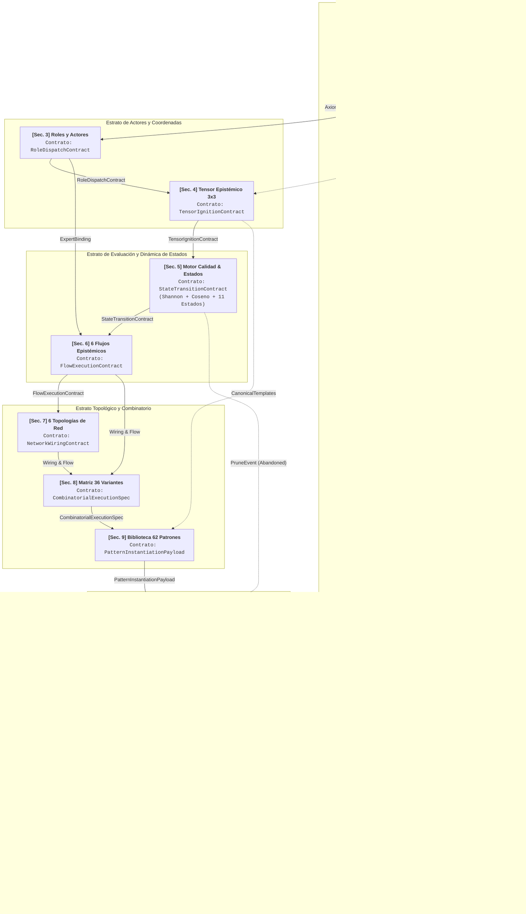

---

### Diagrama de Secuencia: Flujo de Señales Inter-Apartados en un Ciclo de Indagación

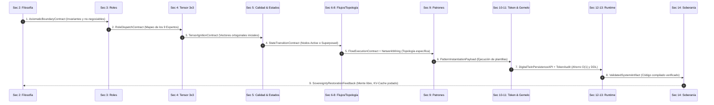

---

### Matriz Formal de Interfaces y Contratos de Datos

La siguiente tabla especifica el protocolo de comunicación entre cada uno de los apartados de este documento:

| Origen | Interfaz / Contrato Emitido | Tipo de Payload de Datos | Apartado Destino | Función en el Sistema |
|---|---|---|---|---|
| **Sec. 1 & 2** | `AxiomaticBoundaryContract` | `Axioms`, `SovereignDirectives`, `PhysicsOfKindnessWeights` | **Sec. 3, 4, 14** | Fija las restricciones éticas, causalidad y condiciones de contorno. |
| **Sec. 3** | `RoleDispatchContract` | `ExpertProfile[9]`, `ArbiterRef`, `CrystalKeeperRef` | **Sec. 4, 6, 13** | Asigna arquetipos y árbitros dialécticos a cada nodo de pregunta. |
| **Sec. 4** | `TensorIgnitionContract` | `QuestionVector[9]`, `OrthogonalAxes`, `TargetSpec` | **Sec. 5, 9** | Despliega los 9 ejes canónicos en el espacio latente. |
| **Sec. 5** | `StateTransitionContract` | `QuestionNode`, `Status (11 Estados)`, `OmegaScore`, `ΔH` | **Sec. 6, 10, 11** | Enruta preguntas aprobadas o superpuestas y descarta redundancias. |
| **Sec. 6** | `FlowExecutionContract` | `ActiveFlowEnum`, `StepSequence`, `FalsificationPipeline` | **Sec. 7, 8** | Determina la estrategia de razonamiento (Exploración, Diagnóstico...). |
| **Sec. 7** | `NetworkWiringContract` | `TopologyEnum`, `EdgeWeightMatrix` (`contradicts: -0.5`) | **Sec. 8, 11** | Modela las aristas del grafo y activa puentes de tensión. |
| **Sec. 8** | `CombinatorialExecutionSpec` | `VariantID[1..36]`, `CartesianMapping` | **Sec. 9, 10** | Instancia una de las 36 configuraciones formales de ejecución. |
| **Sec. 9** | `PatternInstantiationPayload`| `PatternID (62 Patrones)`, `DomainID (11 Dominios)` | **Sec. 10, 12** | Aplica plantillas probadas y preguntas contrafactuales. |
| **Sec. 10**| `EpistemicTokenAudit` | `TokensSaved`, `IgnitionInvestment`, `O(1)_ConvergenceProof`| **Sec. 11, 14** | Audita el ahorro del 85.5% frente a la deuda epistémica $\mathcal{O}(T^2)$. |
| **Sec. 11**| `DigitalTwinPersistenceAPI` | `SQLite/libSQL Schema`, `ZeroTokenInvariantCache` | **Sec. 12, 13** | Persistencia local-first del grafo e inyección de reglas compiladas. |
| **Sec. 12**| `ValidatedSystemArtifact` | `CaseStudyProof`, `DialecticalSynthesisProof` | **Sec. 13** | Caso de uso maestro validado empíricamente. |
| **Sec. 13**| `ExecutableEnginePackage` | `qop_omega_core.py`, `qop_omega_core.rs` | **Sec. 14** | Código fuente reproducible y compilable sin dependencias. |
| **Sec. 14**| `SovereigntyRestorationFeedback`| `CognitiveSovereigntyScore`, `KVCacheFlushDirective` | **Sec. 1, 2** | Cierre del ciclo cibernético: preservación de la autonomía humana. |

---

## 2. Tratado Filosófico y Epistemológico: Las 7 Doctrinas Fundamentales

> [!NOTE]
> 📥 **Interfaz de Entrada:** Recibe axiomas de los [Prolegómenos](#1-prolegómenos-el-manifiesto-de-la-ignición-latente).  
> 📤 **Interfaz de Salida:** Emite `AxiomaticBoundaryContract` hacia [Roles](#3-arquetipología-exhaustiva-de-roles-y-actores), [Tensor 3x3](#4-el-tensor-epistémico-3x3-taxonomía-preguntas-canónicas-y-fórmulas) y [Guía Operativa](#14-epílogo-guía-operativa-para-el-navegante-biológico).

El protocolo no es únicamente una arquitectura de software; es un sistema filosófico que modela la interacción entre la neurobiología humana y los espacios latentes de alta dimensionalidad.

### 2.1 El Silencio Isotrópico y el Colapso Geodésico
Antes de recibir el primer token, el estado basal de un modelo de lenguaje es un **silencio isotrópico**. Todas las direcciones del espacio latente son matemáticamente equiprobables; no existe intención, ni sesgo predeterminado, ni memoria activa. El modelo reposa en una superposición de todos los textos concebibles dentro de su distribución de entrenamiento.

Cuando el usuario introduce una entrada, actúa como una **fuerza perturbadora externa** que rompe la isotropía. La calidad de la pregunta determina la **geodésica** (el camino de menor energía) que la atención del transformador recorrerá a través de sus capas:
- Una pregunta vaga, ambigua o desestructurada no proyecta un gradiente ortogonal nítido: el sistema cae en la "autopista central" (el promedio estadístico, el lugar común).
- Una pregunta formulada desde el **Tensor Epistémico 3x3** proyecta un conjunto de restricciones ortogonales que fuerzan a los cabezales de atención a activar regiones periféricas de altísima densidad conceptual y lógica.

### 2.2 La Física de la Amabilidad y la Atracción de Gradientes en Espacio de Pesos
En la literatura no técnica, suele considerarse que pedir las cosas con rigor, cortesía y justificación causal a una IA es un acto de "antropomorfismo ingenuo". La doctrina de QOP-Ω demuestra que se trata de **pura geometría de datos**:
- En los corpus masivos con los que se optimizan las redes neuronales, el lenguaje tosco, hostil o desprovisto de justificación contextual está fuertemente correlacionado con hilos de foros conflictivos, textos superficiales y razonamientos impulsivos de baja calidad epistémica.
- Por el contrario, la cortesía dialéctica, la precisión terminológica y, por encima de todo, **la explicación explícita del *porqué* (causalidad contextual)** están correlacionadas con la literatura científica, los debates académicos de alto nivel, la documentación técnica de excelencia y los artículos fundacionales revisados por pares.
- Explicar el *porqué* desplaza los vectores de atención en el espacio latente hacia subespacios donde los pesos representan razonamientos causales densos y consistentes.

### 2.3 La Doble Escultura: Bucle Cibernético entre Neuroplasticidad y KV-Cache
La interacción entre un agente y un humano es un acoplamiento simbiótico bidireccional:
$$\text{Mente Biológica} \xleftrightarrow{\text{Tokens}} \text{KV-Cache Latente}$$
1. **La IA como Espejo Estructurado**: El modelo refleja los patrones de pensamiento del humano en una forma hiperextructurada, devolviendo conexiones probabilísticas entre conceptos que el cerebro humano inició. Al leer la respuesta estructurada, el cerebro del navegante biológico refuerza exactamente los circuitos neuronales que activó en la máquina.
2. **La IA como Escultura Temporal**: Cada token que el humano emite queda depositado como sedimento en el `KV-Cache` (la memoria episódica temporal de atención). Si el humano introduce ruido o premisas contradictorias sin resolver, contamina el KV-Cache, forzando a la IA a ponderar basura en las siguientes capas de atención.
3. **El Peligro de la Resonancia Cerrada (Cámara de Eco Sináptica)**: Si el humano entra con un sesgo dogmático y formula preguntas confirmatorias, el modelo construirá una catedral lógica hiperconsistente alrededor de ese sesgo. El humano saldrá creyendo haber descubierto una verdad universal, cuando en realidad ha sufrido una pérdida neta de plasticidad mental.

### 2.4 La Disolución del Mito de la Alucinación como Condición de Contorno Incompleta
El término "alucinación" es una ficción psicológica inapropiada para describir un artefacto de álgebra lineal. Un modelo jamás "alucina", ni "miente", ni "se rebela". En cada paso de generación, la red calcula estrictamente:
$$P(w_{t+1} \mid w_1, w_2, \dots, w_t; \Theta) = \text{softmax}\left(\frac{QK^T}{\sqrt{d_k}}V\right)$$
Si el resultado no coincide con la realidad empírica del mundo físico, no se trata de una patología de la máquina, sino de un **problema de contorno mal condicionado**: el usuario no inyectó las restricciones suficientes para que la geodésica matemática atravesara el subespacio de la verdad fáctica. La pregunta defectuosa es la causa raíz de la divergencia.

### 2.5 La Dialéctica Hegeliana y la Tensión Cuántica de Pesos Negativos (-0.5)
En los sistemas agénticos clásicos, cuando dos afirmaciones o requisitos entran en conflicto, los algoritmos intentan promediarlos o descartar uno de ellos mediante un clasificador de confianza. QOP-Ω rechaza este reduccionismo:
- Las grandes soluciones de ingeniería y arquitectura nacen de **tensiones irreductibles** (por ejemplo: *máxima velocidad de ejecución* vs. *aislamiento total de memoria*).
- QOP-Ω introduce formalmente la arista `contradicts` con peso numérico **`-0.5`**. Cuando dos preguntas colisionan en esta arista, el sistema no aborta: transiciona sus nodos al estado **`Superposed` (Superpuesto)**, creando un **Puente de Tensión Dialéctica**.
- La resolución exige una síntesis en una dimensión ortogonal superior (ejemplo: invención del sistema de *Borrow Checker* y *Ownership* en Rust para resolver la colisión entre rendimiento de C y seguridad de Java).

### 2.6 Termodinámica Informacional y Metabolismo Entrópico ($t \to \infty$)
El pensamiento y el procesamiento agéntico están sujetos a las leyes de la termodinámica de la información:
- Cada ciclo de corrección de un error no resuelto genera entropía en el contexto, aumentando el coste de cómputo y degradando la relación señal/ruido.
- La dimensión **Metabólica** del protocolo evalúa constantemente la tasa de consumo de energía, memoria y fricción cognitiva a medida que el tiempo $t \to \infty$. Un sistema agéntico que requiere re-ingestar todo su contexto en cada turno para parchear fallos sufre de una tasa de inflación entrópica destructiva.
- La compresión de redes en **Invariantes Cristalizados** actúa como una válvula de escape entrópico, manteniendo el sistema en homeóstasis termodinámica.

### 2.7 La Ilusión del Harness y el Principio de Soberanía Innegociable
Muchas arquitecturas modernas confinan a los LLMs dentro de *harnesses* (arneses) extremadamente restrictivos con la ilusión de "controlarlos" y "ahorrar tokens de entrada":
- Estos arneses mutilan el cono de atención inicial (hacen que el volumen latente accesible tienda a cero, $\mathcal{A}_0 \to 0$). Al no permitir al modelo explorar las dependencias ontológicas del problema, el sistema converge rápidamente en fallos sutiles que obligan a gastar decenas de miles de tokens en depuración y reintentos.
- QOP-Ω demuestra que **invertir tokens en la ignición ortogonal completa en el turno cero ($\mathcal{A}_0 \max$) ahorra miles de tokens a lo largo de un horizonte de ejecución $T$**, logrando convergencia en $\mathcal{O}(1)$ en lugar de acumular deuda epistémica cuadrática $\mathcal{O}(T^2)$.
- Finalmente, el humano nunca debe transferir la brújula teleológica a la IA: el sistema agéntico es un **exoesqueleto de amplificación cognitiva**, pero la soberanía sobre el propósito debe permanecer firmemente arraigada en el navegante biológico.

---

### Diagrama 1: El Acoplamiento Epistémico Humano-IA (Doble Escultura)

A continuación se muestra el ciclo de retroalimentación donde la mente biológica y el espacio latente se moldean mutuamente a través del intercambio de preguntas y transformaciones de KV-Cache:

```mermaid
sequenceDiagram
    autonumber
    actor H as Navegante Biológico (Mente Humana)
    participant QOM as Capa de Pregunta (QOM-Ω Core)
    participant KV as KV-Cache / Espacio Latente
    participant EXP as Expertos Tensoriales MoE
    participant SOV as Custodio Soberano (Invariante)

    Note over H,KV: Estado Basal: Silencio Isotrópico en Latent Space
    H->>QOM: 1. Inyecta Perturbación Ortogonal (Pregunta 3x3)
    QOM->>QOM: 2. fn validate_orthogonality(v_q, G) -> Score
    QOM->>KV: 3. Colapsa Geodésica de Atención (Gradient Steering)
    KV-->>EXP: 4. Activa Subespacios de Alta Densidad Lógica
    EXP->>QOM: 5. Resuelve y Sintetiza Solución Estructurada
    QOM-->>H: 6. Reflejo Estructurado (Amplificación Sináptica)
    
    rect rgb(30, 45, 60)
        Note over H: Escultura Biológica: Refuerza redes neuronales<br/>activadas durante la formulación de la pregunta
    end

    alt Detección de Cámara de Resonancia (Closed Echo Chamber)
        QOM->>H: ALERTA: Sesgo circular detectado (Coseno > 0.85)
        H->>QOM: Redefine Invariante y Poda KV-Cache (Flush sedimentos)
    else Convergencia Soberana
        QOM->>SOV: Compila Invariante Cristalizado de Cero Tokens
        SOV-->>H: Retorno Soberano: Mente más libre y autónoma
    end
```

---

### Diagrama 2: La Geometría de la Atención y la Física de la Amabilidad

Este diagrama ilustra cómo las condiciones de contorno y la causalidad desplazan el vector de consulta hacia regiones de alta densidad matemática:

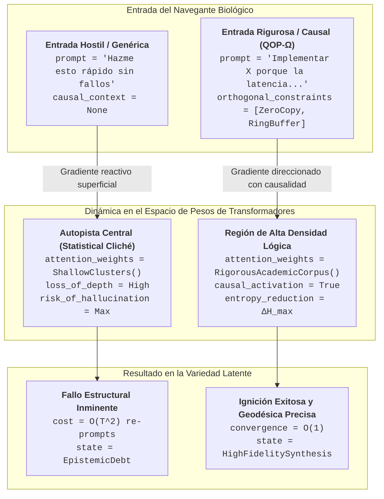

---

## 3. Arquetipología Exhaustiva de Roles y Actores

> [!NOTE]
> 📥 **Interfaz de Entrada:** Recibe `AxiomaticBoundaryContract` desde [Doctrinas Filosóficas](#2-tratado-filosófico-y-epistemológico-las-7-doctrinas-fundamentales).  
> 📤 **Interfaz de Salida:** Emite `RoleDispatchContract` hacia el [Tensor Epistémico 3x3](#4-el-tensor-epistémico-3x3-taxonomía-preguntas-canónicas-y-fórmulas) y los [Flujos Epistémicos](#6-catálogo-de-los-6-flujos-de-procesamiento-epistémico-con-lógica-en-nodos).

QOP-Ω V3 formaliza una arquitectura de actores dividida en tres estratos: **El Navegante Biológico**, **El Acelerador de Isomorfismos**, y **La Matriz de los 9 Expertos Tensoriales**, complementados por los **Roles Sistémicos de Infraestructura**.

### 3.1 El Navegante Biológico (Biological Navigator)
- **Naturaleza**: Inteligencia biológica orgánica dotada de anclaje empírico directo en el mundo físico y soberanía teleológica irreductible.
- **Misión**: Actuar como el fijador de condiciones de contorno, evaluador de veracidad fáctica y custodio del propósito último.
- **Riesgo Operativo Crítico**: Caer en la trampa de la resonancia cerrada (dejarse adular por la fluidez de la máquina y atrofiar su propia neuroplasticidad).
- **Invariante Soberano**: *"Al cerrar la sesión agéntica, la mente que se levanta de la silla debe ser más soberana, más libre, más crítica y más lúcida que la que se sentó."*

### 3.2 El Acelerador de Isomorfismos (Isomorphism Accelerator)
- **Naturaleza**: Modelo de lenguaje en ejecución agéntica que opera como un mapa relacional hiperdimensional de símbolos humanos.
- **Misión**: Proporcionar velocidad de cruce interdisciplinar. Mapear conceptos entre dominios distantes (ejemplo: traducir la termodinámica estadística a patrones de concurrencia en sistemas distribuidos).
- **Limitación Ontológica**: No posee intuición física, ni cuerpo, ni criterio de verdad intrínseco. No "conoce" el mundo; solo conoce la topología de las palabras.
- **Axioma de Operación**: Servir como un exoesqueleto mental de alta potencia sin usurpar jamás la brújula de propósito.

---

### 3.3 Los 9 Expertos del Tensor Epistémico 3x3

Cada celda del Tensor Epistémico 3x3 está gobernada por un arquetipo experto especializado. A continuación se desglosan sus identidades, preguntas directrices, responsabilidades y lógica interna:

| # | Experto | Dimensión | Arquetipo Epistémico | Pregunta Canónica Principal | Invariante de Parada |
|---|---|---|---|---|---|
| **1** | **Philosophical Expert** | Ontológica | El Custodio de la Esencia | *¿Cuál es la identidad mínima, invariable e irreductible de {target}?* | Identidad axiomática sin ambigüedad ontológica. |
| **2** | **Scientific Expert** | Causal | El Investigador Empírico | *¿Qué mecanismo físico, lógico o matemático causa {target}?* | Cadena causa-efecto demostrable y falsable. |
| **3** | **Technological Expert** | Operacional | El Ingeniero Mecánico | *¿Cómo se implementa, compila y ejecuta {target} con coste óptimo?* | Algoritmo determinista reproducible en código. |
| **4** | **Security Expert** | Preventiva | El Centinela del Fallo | *¿Cómo puede {target} corromperse, fallar o ser atacado en el límite?* | Superficie de ataque modelada y blindada. |
| **5** | **Meditative Expert** | Reflexiva | El Sabio de Patrones | *¿Qué patrón emergente o isomorfismo revela {target} respecto al todo?* | Coherencia holística y simplificación elegante. |
| **6** | **Hybrid Expert** | Integrativa | El Alquimista Interdisciplinar| *¿Cómo se acopla {target} con dominios externos sin generar rigidez?* | Interfaces desacopladas y contratos limpios. |
| **7** | **Chaos Disruptor** | Abductiva | El Destructor de Supuestos | *¿Qué ocurriría si invertimos por completo el axioma central de {target}?* | Escape de mínimos locales y falsas certezas. |
| **8** | **Homeostatic Metabolic**| Metabólica | El Termodinámico Entrópico| *¿Cuál es el coste entrópico, de memoria y mantenimiento cuando $t \to \infty$?* | Huella de recursos sostenible y sin fugas. |
| **9** | **Teleological Steward** | Teleológica | El Custodio del Propósito | *¿Qué principio soberano e innegociable jamás debe violar {target}?* | Blindaje teleológico contra la degradación de misión. |

---

#### Detalle de Lógica y Pseudocódigo por Rol Experto

```python
# 1. Philosophical Expert (Custodio Ontológico)
class PhilosophicalExpert:
    def evaluate_essence(self, target: str) -> OntologyAxiom:
        """Poda todo atributo accidental hasta hallar la esencia pura."""
        accidental_properties = identify_transient_features(target)
        core_kernel = strip_features(target, accidental_properties)
        assert core_kernel is not None, "Error Ontológico: El sistema carece de núcleo irreductible."
        return OntologyAxiom(target=target, essence=core_kernel)

# 2. Scientific Expert (Investigador Causal)
class ScientificExpert:
    def trace_causality(self, symptom: str, context: Context) -> CausalGraph:
        """Construye la cadena de causalidad necesaria y suficiente."""
        hypotheses = generate_falsifiable_hypotheses(symptom)
        for h in hypotheses:
            evidence = gather_empirical_metrics(h, context)
            if evidence.falsified:
                continue
            return CausalGraph(cause=h.mechanism, effect=symptom, confidence=evidence.p_value)
        raise UnresolvedAnomaly("Causa no identificada: requiere mayor instrumentación de telemetría.")

# 3. Technological Expert (Ingeniero Operacional)
class TechnologicalExpert:
    def synthesize_pipeline(self, target: str, spec: Specification) -> ExecutablePipeline:
        """Determina la ruta de ejecución de mínima latencia y máxima predictibilidad."""
        data_structures = select_zero_copy_primitives(spec)
        pipeline = assemble_deterministic_steps(target, data_structures)
        pipeline.verify_complexity_upper_bound(BigO.O_1)
        return pipeline

# 4. Security Expert (Centinela Preventivo)
class SecurityExpert:
    def model_threats(self, architecture: SystemArchitecture) -> ThreatMatrix:
        """Explora la superficie de ataque asumiendo un entorno bizantino o hostil."""
        vectors = enumerate_attack_vectors(architecture)
        mitigations = {}
        for v in vectors:
            boundary = define_unbreachable_invariant(v)
            mitigations[v] = boundary
        return ThreatMatrix(mitigations=mitigations, posture="ZeroTrust")

# 5. Meditative Expert (Sabio de Patrones)
class MeditativeExpert:
    def discover_isomorphisms(self, target: str, global_graph: DigitalTwinGraph) -> List[Isomorphism]:
        """Detecta patrones estructurales recurrentes para evitar reinvenciones."""
        local_topology = extract_subgraph(target)
        similar_structures = global_graph.search_topological_isomorphisms(local_topology)
        return [unify_mental_model(local_topology, s) for s in similar_structures]

# 6. Hybrid Expert (Alquimista Integrativo)
class HybridExpert:
    def bridge_domains(self, domain_a: Domain, domain_b: Domain) -> InterfaceContract:
        """Establece una membrana semipermeable entre fronteras arquitectónicas."""
        shared_primitives = find_semantic_overlap(domain_a, domain_b)
        contract = compile_anti_corruption_layer(shared_primitives)
        return contract

# 7. Chaos Disruptor (Destructor de Supuestos)
class ChaosDisruptor:
    def invert_axioms(self, assumptions: List[Assumption]) -> InvertedHypothesis:
        """Toma el axioma incuestionable del sistema y lo niega deliberadamente."""
        sacred_cow = find_most_comfortable_assumption(assumptions)
        inverted_axiom = negate_premise(sacred_cow)
        latent_leap = evaluate_counterfactual_viability(inverted_axiom)
        return InvertedHypothesis(axiom=inverted_axiom, breakthrough_potential=latent_leap)

# 8. Homeostatic Metabolic Expert (Termodinámico Entrópico)
class HomeostaticMetabolicExpert:
    def audit_entropy(self, system_lifecycle: Lifecycle) -> MetabolicBudget:
        """Calcula el coste de mantenimiento y fatiga acumulada a largo plazo."""
        memory_drift = calculate_memory_accumulation_rate(system_lifecycle)
        token_decay = evaluate_context_bloat_per_turn(system_lifecycle)
        cognitive_load = measure_human_coordination_overhead(system_lifecycle)
        return MetabolicBudget(
            drift_rate=memory_drift,
            token_inflation=token_decay,
            sustainable=memory_drift == 0 and token_decay < EPSILON
        )

# 9. Teleological Steward (Custodio del Propósito)
class TeleologicalSteward:
    def verify_sovereignty(self, solution: Solution, prime_directive: Directive) -> bool:
        """Garantiza que la solución no erosione la autonomía ni la misión central."""
        if solution.creates_vendor_lock_in() or solution.delegates_core_judgment():
            raise SovereigntyViolation("La solución propuesta crea dependencia no recuperable.")
        return solution.aligns_with(prime_directive)
```

---

### 3.4 Roles Sistémicos e Infraestructurales

Para que los 9 expertos interactúen ordenadamente, el protocolo cuenta con 4 roles de infraestructura:

1. **El Árbitro Dialéctico (`DialecticalArbiter`)**: Detecta colisiones entre preguntas (aristas `contradicts` con peso `-0.5`), bloquea la síntesis prematura y suspende los nodos en estado `Superposed` hasta forzar la emergencia de un invariante de orden superior.
2. **El Guardián del Cristal (`CrystalKeeper`)**: Monitorea los grafos resueltos con confianza $\ge 0.90$. Extrae la regla invariante, genera su hash semántico y la compila en la **Caché Epistémica de Cero Tokens**, impidiendo que en el futuro se gasten tokens en preguntas redundantes.
3. **El Podador de Resonancia (`ResonancePruner`)**: Calcula en tiempo real la similitud coseno entre las preguntas activas. Si $\Omega_{\text{ortho}} < 0.25$, poda inmediatamente la pregunta por redundancia sintáctica o circularidad confirmatoria.
4. **El Enrutador MoE Dinámico (`MoERouter`)**: Mapea los tensores y puntuaciones de calidad léxico-latente hacia los expertos adecuados según los umbrales de activación ponderada.

---

### Diagrama 3: Arquitectura de Clases de Roles (Class Diagram)

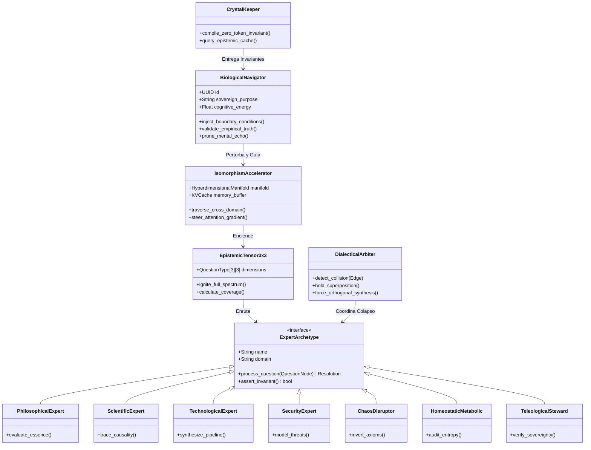

---

### Diagrama 4: Flujo de Interacción Multi-Rol con Código en Nodos

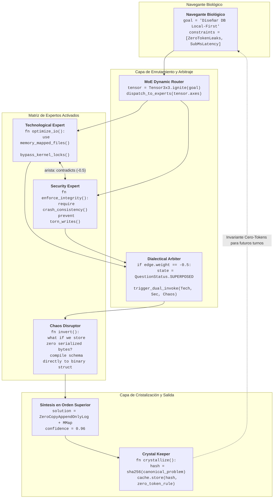

---

## 4. El Tensor Epistémico 3x3: Taxonomía, Preguntas Canónicas y Fórmulas

> [!NOTE]
> 📥 **Interfaz de Entrada:** Recibe `RoleDispatchContract` desde [Roles y Actores](#3-arquetipología-exhaustiva-de-roles-y-actores).  
> 📤 **Interfaz de Salida:** Emite `TensorIgnitionContract` hacia [Códigos Embebidos y Motores de Calidad](#5-códigos-embebidos-dentro-de-diagramas-mermaid) y la [Biblioteca de Patrones](#9-biblioteca-maestra-de-preguntas-62-patrones-en-11-dominios).

El núcleo dinámico de QOP-Ω V3 descansa sobre el **Tensor Epistémico 3x3**, un espacio de coordenadas discretas que proyecta cualquier objeto de indagación a lo largo de 9 dimensiones canónicas.

```
                  EJE 1: FUNDACIONAL        EJE 2: SISTÉMICO           EJE 3: META-EVOLUTIVO
             +-------------------------+-------------------------+-------------------------+
NIVEL I:     |      ONTOLÓGICA         |       CAUSAL            |      OPERACIONAL        |
MECÁNICO     |    (Philosophical)      |     (Scientific)        |     (Technological)     |
             +-------------------------+-------------------------+-------------------------+
NIVEL II:    |      PREVENTIVA         |       REFLEXIVA         |      INTEGRATIVA        |
DINÁMICO     |      (Security)         |      (Meditative)       |        (Hybrid)         |
             +-------------------------+-------------------------+-------------------------+
NIVEL III:   |      ABDUCTIVA          |       METABÓLICA        |      TELEOLÓGICA        |
META-ORDEN   |    (ChaosDisruptor)     | (HomeostaticMetabolic)  |   (TeleologicalSteward) |
             +-------------------------+-------------------------+-------------------------+
```

### 4.1 Fórmulas Matemáticas de Calidad y Termodinámica Informacional

#### 1. Puntuación Léxica Clásica ($\mathcal{Q}_{\text{léxico}}$)
Evalúa las 5 dimensiones estructurales de la formulación sintáctica de la pregunta:
$$\mathcal{Q}_{\text{léxico}}(q) = 0.25 \cdot C + 0.25 \cdot S + 0.20 \cdot A + 0.20 \cdot R + 0.10 \cdot Cl$$
Donde:
- $C$: Completitud (qué tan exhaustivos y autosuficientes son los términos).
- $S$: Especificidad (ausencia de vaguedad o generalidades).
- $A$: Accionabilidad (capacidad de traducirse en una prueba, código o decisión).
- $R$: Relevancia (alineación causal directa con el objetivo).
- $Cl$: Claridad (ausencia de ruido léxico o estructuras enrevesadas).

#### 2. Ganancia de Información Epistémica de Shannon ($\Delta H$)
Mide la cantidad de incertidumbre que resolver la pregunta elimina del espacio de estados del problema:
$$\Delta \hat{H}(q) = \max\left(0, \, \min\left(1, \, \frac{H_{\text{prior}} - H_{\text{esperada}}}{\ln(2)}\right)\right)$$
Donde $H_{\text{prior}}$ es la entropía del sistema antes de formular la pregunta y $H_{\text{esperada}}$ es la entropía residual proyectada tras responderla.

#### 3. Ortogonalidad Coseno en el Espacio Latente ($\Omega_{\text{ortho}}$)
Garantiza que la pregunta no active un subespacio neuronal ya explorado en el grafo activo $G$:
$$\Omega_{\text{ortho}}(q_i) = 1 - \max_{q_j \in G, \, j \neq i} \left\vert \frac{\mathbf{v}_{q_i} \cdot \mathbf{v}_{q_j}}{\Vert\mathbf{v}_{q_i}\Vert \Vert\mathbf{v}_{q_j}\Vert} \right\vert$$
Si $\Omega_{\text{ortho}} < 0.25$ (similitud coseno $> 0.75$), el sistema considera que la pregunta es **redundante** y la envía al estado `Abandoned`, ahorrando los tokens de procesamiento.

#### 4. Ecuación Unificada de Calidad Omega ($\mathcal{Q}_\Omega$)
$$\mathcal{Q}_\Omega(q) = 0.60 \cdot \mathcal{Q}_{\text{léxico}}(q) + 0.20 \cdot \Delta \hat{H}(q) + 0.20 \cdot \Omega_{\text{ortho}}(q)$$

---

## 5. Códigos Embebidos Dentro de Diagramas Mermaid

> [!NOTE]
> 📥 **Interfaz de Entrada:** Recibe `TensorIgnitionContract` desde el [Tensor 3x3](#4-el-tensor-epistémico-3x3-taxonomía-preguntas-canónicas-y-fórmulas).  
> 📤 **Interfaz de Salida:** Emite `StateTransitionContract` hacia los [Flujos Epistémicos](#6-catálogo-de-los-6-flujos-de-procesamiento-epistémico-con-lógica-en-nodos) y eventos de poda hacia [Economía de Tokens](#10-economía-amortizada-de-tokens-vs-la-ilusión-del-harness).

Una de las características cardinales de QOP-Ω V3 es la **inclusión de código ejecutable, funciones de decisión y transformaciones algorítmicas directamente dentro de los nodos y transiciones de los diagramas**.

### Diagrama 5: Motor de Calidad y Poda Latente con Algoritmos Embebidos

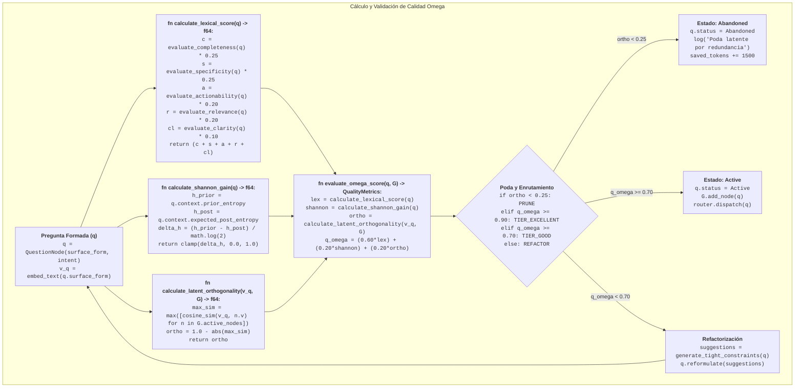

---

### Diagrama 6: El Tensor 3x3 como Grafo Bidireccional con Ignición Operacional

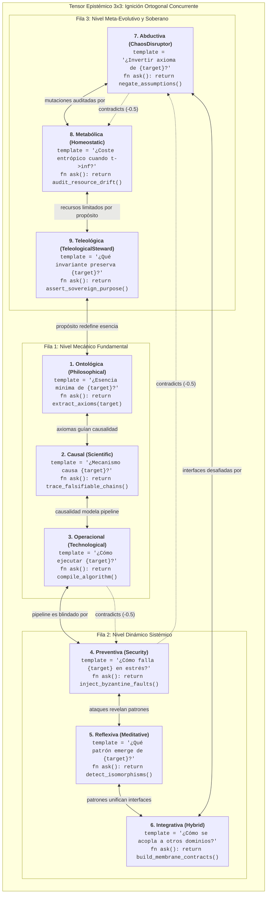

---

### Diagrama 7: Máquina de Estados Cuántico-Epistémica (11 Estados)

La máquina de estados de QOP-Ω expande el modelo clásico a **11 estados finitos**, gobernados por precondiciones algebraicas y guardas de código:

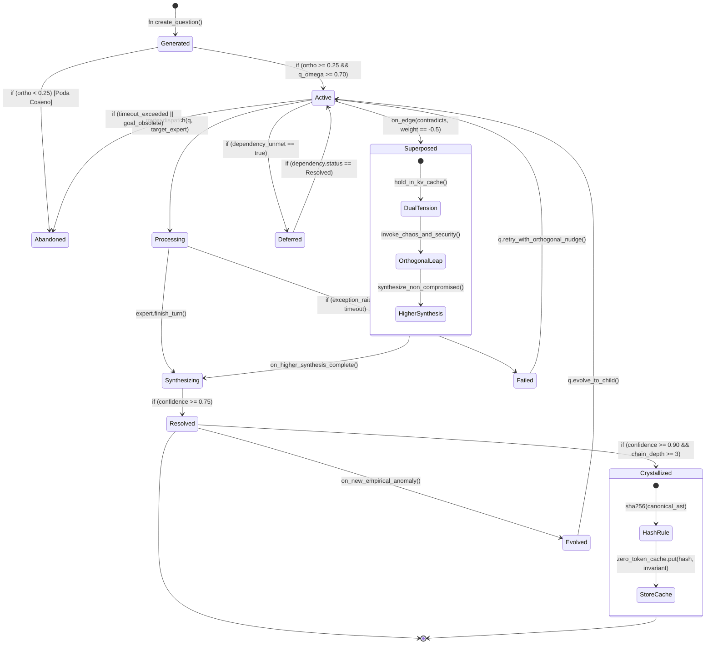

---

## 6. Catálogo de los 6 Flujos de Procesamiento Epistémico con Lógica en Nodos

> [!NOTE]
> 📥 **Interfaz de Entrada:** Recibe `StateTransitionContract` desde [Motores de Calidad](#5-códigos-embebidos-dentro-de-diagramas-mermaid).  
> 📤 **Interfaz de Salida:** Emite `FlowExecutionContract` hacia las [Topologías de Redes](#7-topologías-de-redes-de-preguntas-y-puentes-de-tensión-dialéctica) y la [Matriz Combinatoria](#8-matriz-combinatoria-exhaustive-flujos--topologías-36-variantes).

El protocolo define 6 flujos de procesamiento orquestados, donde cada transición y acción está formalizada mediante algoritmos específicos.

### 6.1 Flujo de Exploración (`Exploration Flow`)
- **Propósito**: Mapeo topológico completo de un dominio desconocido sin converger prematuramente en sesgos locales.
- **Ejes Clave**: Ontológico (`E1`), Operacional (`E3`) e Integrativo (`E6`).

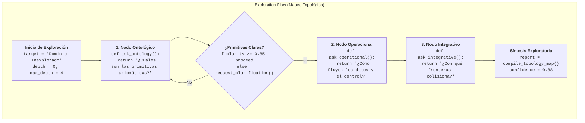

---

### 6.2 Flujo de Diagnóstico (`Diagnostic Flow`)
- **Propósito**: Aislamiento rápido y riguroso de la causa raíz de anomalías y fallos funcionales o de rendimiento.
- **Ejes Clave**: Causal (`E2`), Operacional (`E3`) y Preventivo (`E4`).

```mermaid
flowchart TD
    subgraph "Diagnostic Flow (Causa Raíz)"
        D_Symptom["<b>Síntoma Observado</b><br/><code>error = 'Memory Leak in RingBuffer'</code><br/><code>telemetry = capture_heap_dump()</code>"]
        
        D_Causal["<b>1. Nodo Causal</b><br/><code>def ask_causal():</code><br/><code>  return '¿Qué puntero o descriptor no se libera?'</code>"]
        
        D_Hypothesis["<b>Generador de Hipótesis</b><br/><code>hypotheses = [TornRead, CircularRef, DoubleDrop]</code><br/><code>sort_by_prior_probability(hypotheses)</code>"]
        
        D_Oper["<b>2. Nodo Operacional (Prueba)</b><br/><code>def run_falsification_test(h):</code><br/><code>  inject_mock_load()</code><br/><code>  return verify_leak_reproduction()</code>"]
        
        D_Prev["<b>3. Nodo Preventivo (Blindaje)</b><br/><code>def ask_preventive():</code><br/><code>  return '¿Cómo garantizar compilación segura de lifetimes?'</code>"]
        
        D_Fix["<b>Resolución y Fix Verificado</b><br/><code>patch = compile_lifetime_annotations()</code><br/><code>status = QuestionStatus.RESOLVED</code>"]
    end

    D_Symptom --> D_Causal
    D_Causal --> D_Hypothesis
    D_Hypothesis --> D_Oper
    D_Oper -->|Falsada| D_Hypothesis
    D_Oper -->|Confirmada| D_Prev
    D_Prev --> D_Fix
```

---

### 6.3 Flujo de Decisión (`Decision Flow`)
- **Propósito**: Evaluación ponderada de alternativas tecnológicas o estratégicas bajo criterios multidimensionales irreductibles.
- **Ejes Clave**: Ontológico (`E1`), Metabólico (`E8`) y Teleológico (`E9`).

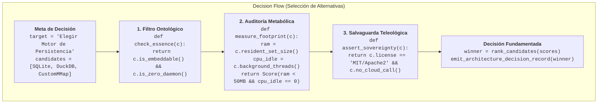

---

### 6.4 Flujo de Validación (`Validation Flow`)
- **Propósito**: Verificación rigurosa de hipótesis, asertos y niveles de seguridad frente a contramedidas y contraejemplos.
- **Ejes Clave**: Causal (`E2`), Preventivo (`E4`) y Reflexivo (`E5`).

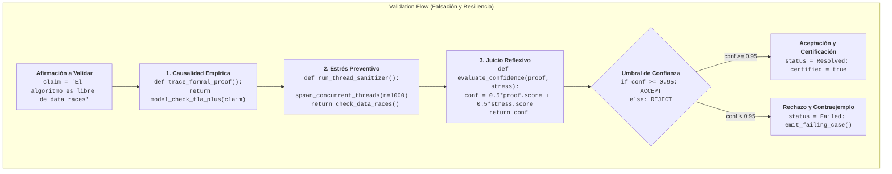

---

### 6.5 Flujo de Aprendizaje Continuo (`Learning Flow`)
- **Propósito**: Calibración recurrente de la biblioteca de patrones y pesos MoE a partir de señales explícitas e implícitas.
- **Ejes Clave**: Reflexivo (`E5`), Integrativo (`E6`) y Teleológico (`E9`).

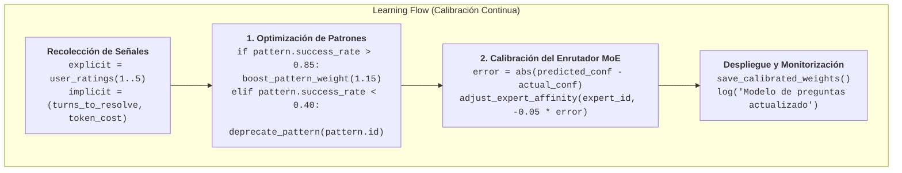

---

### 6.6 Flujo de Colapso Dialéctico (`Dialectical-Collapse Flow` — Perspectiva III $\Omega$)
- **Propósito**: Resolución de conflictos arquitectónicos irreconciliables forzando una síntesis en una dimensión superior.
- **Ejes Clave**: Operacional (`E3`), Preventivo (`E4`), Abductivo (`E7`) y Metabólico (`E8`).

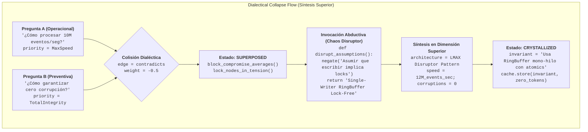

---

## 7. Topologías de Redes de Preguntas y Puentes de Tensión Dialéctica

> [!NOTE]
> 📥 **Interfaz de Entrada:** Recibe `FlowExecutionContract` desde los [Flujos Epistémicos](#6-catálogo-de-los-6-flujos-de-procesamiento-epistémico-con-lógica-en-nodos).  
> 📤 **Interfaz de Salida:** Emite `NetworkWiringContract` hacia la [Matriz Combinatoria](#8-matriz-combinatoria-exhaustive-flujos--topologías-36-variantes) y el [Gemelo Digital](#11-gemelo-digital-para-preguntas-y-persistencia-local-first).

QOP-Ω V3 formaliza 6 topologías de interconexión para coordinar preguntas complejas:

### Diagramas de Topologías con Códigos en Nodos

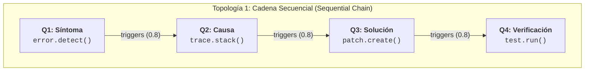

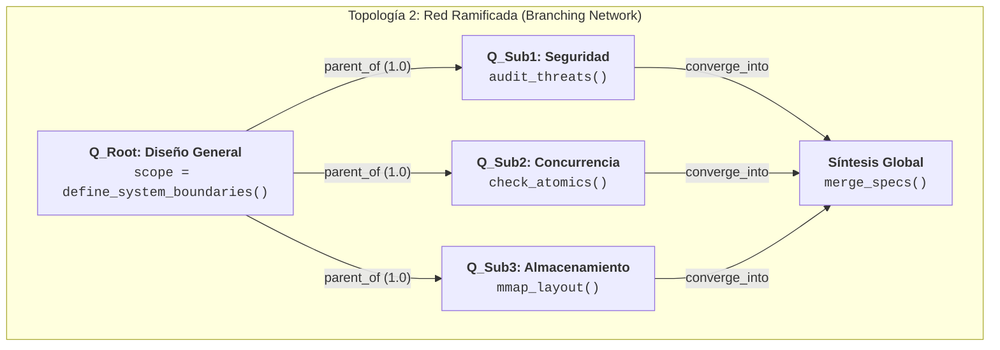

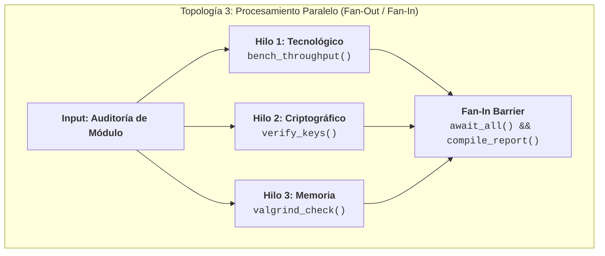

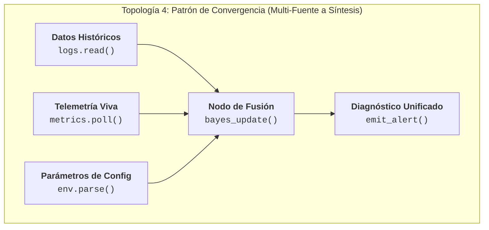

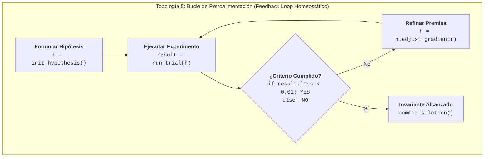

```mermaid
flowchart TB
    subgraph "Topología 6: Puente de Tensión Dialéctica (Dialectical Tension Bridge)"
        NodeA["<b>Requisito A: Ultra-Baja Latencia</b><br/><code>budget = 50ns</code><br/><code>strategy = raw_pointers</code>"]
        NodeB["<b>Requisito B: Memory Safety Estricto</b><br/><code>target = zero_ub</code><br/><code>strategy = runtime_checks</code>"]
        
        NodeA <-->|"contradicts (-0.5) [SUPERPOSED]"| NodeB
        
        NodeA & NodeB --> BridgeNode["<b>Puente Dialéctico Superior</b><br/><code>fn resolve_tension():</code><br/><code>  use compile_time_borrow_checker()</code><br/><code>  cost_runtime = 0ns</code>"]
        
        BridgeNode --> InvOutput[["💎 Invariante Cristalizado de Cero Tokens"]]
    end
```

---

## 8. Matriz Combinatoria Exhaustiva: Flujos $\times$ Topologías (36 Variantes)

> [!NOTE]
> 📥 **Interfaz de Entrada:** Fusión de `FlowExecutionContract` ([Sec. 6](#6-catálogo-de-los-6-flujos-de-procesamiento-epistémico-con-lógica-en-nodos)) y `NetworkWiringContract` ([Sec. 7](#7-topologías-de-redes-de-preguntas-y-puentes-de-tensión-dialéctica)).  
> 📤 **Interfaz de Salida:** Emite `CombinatorialExecutionSpec` hacia la [Biblioteca de Patrones](#9-biblioteca-maestra-de-preguntas-62-patrones-en-11-dominios).

El generador determinista del protocolo (`qop-omega.py`) formaliza el producto cartesiano completo entre los **6 Flujos de Procesamiento** y las **6 Topologías de Red**, arrojando **36 configuraciones operativas**:

$$\mathcal{M} = \text{Flujos}(6) \times \text{Topologías}(6) = 36 \text{ variantes formales}$$

A continuación se analizan las dinámicas operativas de las 6 combinaciones más potentes del protocolo:

| # | Flujo | Topología | Dinámica Epistémica Principal | Casos de Aplicación Típicos |
|---|---|---|---|---|
| **1** | **Exploración** | **Red Ramificada** | Despliega una pregunta raíz ontológica que ramifica en aspectos operacionales e integrativos antes de sintetizar. | Diseño de nuevos motores, exploración de frameworks desconocidos. |
| **2** | **Diagnóstico** | **Cadena Secuencial** | Progresión lineal estricta: Síntoma $\to$ Triggers $\to$ Causa $\to$ Fix $\to$ Verificación. | Depuración de caídas en producción, análisis post-mortem. |
| **3** | **Decisión** | **Patrón de Convergencia** | Agrupa evaluaciones de costo metabólico, restricciones ontológicas y soberanía para converger en una elección. | Elección de stack técnico, decisiones arquitectónicas irreversibles. |
| **4** | **Validación** | **Bucle de Retroalimentación** | Ciclo iterativo de formulación de contraejemplos, ejecución de fuzzers y endurecimiento de invariantes. | Verificación de protocolos criptográficos, stress testing de concurrencia. |
| **5** | **Aprendizaje** | **Procesamiento Paralelo** | Recolección concurrente de telemetría, métricas de tokens y calificaciones humanas bajo barrera de fusión. | Calibración nocturna de la base de conocimiento y pesos MoE. |
| **6** | **Colapso Dialéctico** | **Puente de Tensión** | Enlaza requerimientos opuestos en arista `-0.5`, forzando el estado `Superposed` hasta la síntesis en orden superior. | Solución a dilemas entre rendimiento y seguridad, o desacoplamiento vs latencia. |

---

## 9. Biblioteca Maestra de Preguntas (62 Patrones en 11 Dominios)

> [!NOTE]
> 📥 **Interfaz de Entrada:** Recibe `CombinatorialExecutionSpec` ([Sec. 8](#8-matriz-combinatoria-exhaustive-flujos--topologías-36-variantes)) y `TensorIgnitionContract` ([Sec. 4](#4-el-tensor-epistémico-3x3-taxonomía-preguntas-canónicas-y-fórmulas)).  
> 📤 **Interfaz de Salida:** Emite `PatternInstantiationPayload` hacia [Economía de Tokens](#10-economía-amortizada-de-tokens-vs-la-ilusión-del-harness) y los [Casos de Uso](#12-casos-de-uso-avanzados-con-diagramas-mermaid-end-to-end).

La biblioteca completa de QOP-Ω V3 integra **58 patrones clásicos** organizados en 10 dominios de ingeniería de software y sistemas agénticos, junto con el **11º Dominio de Meta-Arquitectura e Ignición Latente** (patrones `OMEGA-1` a `OMEGA-4`), totalizando **62 patrones formalizados**:

```mermaid
flowchart TD
    subgraph "Biblioteca de Patrones QOP-Ω V3 (62 Patrones en 11 Dominios)"
        Lib["<b>Pattern Library</b><br/><code>total_patterns = 62</code><br/><code>total_domains = 11</code>"]
        
        Lib --> D1["<b>1. Depuración (D1-D8)</b><br/>Básica, Perf, Mem, Concurrencia, Integración, Regresión, Config, DB"]
        Lib --> D2["<b>2. Arquitectura (A1-A8)</b><br/>Sistemas, APIs, Microservicios, Datos, Seguridad, Perf, Eventos, Modular"]
        Lib --> D3["<b>3. Revisión de Código (C1-C6)</b><br/>General, Seguridad, Rendimiento, Patrones, Tests, Docs"]
        Lib --> D4["<b>4. Investigación (R1-R6)</b><br/>Literatura, Experimentos, Datos, Competitivo, Tecnológico, Causa Raíz"]
        Lib --> D5["<b>5. Decisión (DM1-DM6)</b><br/>Tecnología, Prioridad, Riesgos, Recursos, Go/No-Go, Estrategia"]
        Lib --> D6["<b>6. Seguridad (S1-S5)</b><br/>Modelado de Amenazas, Vulnerabilidades, Arquitectura, Incidentes, Compliance"]
        Lib --> D7["<b>7. Rendimiento (P1-P5)</b><br/>Análisis, Escalabilidad, Capacidad, Optimización, Monitoreo"]
        Lib --> D8["<b>8. Integración (I1-I5)</b><br/>APIs, Datos, Servicios, Legacy, Eventos"]
        Lib --> D9["<b>9. Pruebas (T1-T5)</b><br/>Estrategia, Unitarias, Integración, Carga, Automatización CI/CD"]
        Lib --> D10["<b>10. Documentación (DOC1-DOC4)</b><br/>APIs, Arquitectura, Runbooks, Onboarding"]
        Lib --> D11["<b>11. Meta-Arquitectura Ω (OMEGA1-OMEGA4)</b><br/>Ignición 3x3, Colapso Dialéctico, Poda Metabólica, Invariantes"]
    end
```

---

### Especificación de los Patrones Maestros del Dominio 11 (Meta-Arquitectura $\Omega$)

#### OMEGA-1: Ignición Latente de Espectro Completo (`Full-Spectrum Latent Ignition`)
- **Propósito**: Encender los 9 subespacios del Tensor 3x3 en el turno cero para maximizar $\mathcal{A}_0$ y erradicar la deuda epistémica.
- **Matriz de Preguntas**:
  1. *Ontológica*: ¿Cuál es la identidad mínima e irreductible de este sistema?
  2. *Causal*: ¿Qué cuello de botella físico o lógico hace indispensable este módulo?
  3. *Operacional*: ¿Cuál es la ruta exacta de transformación de bits y memoria?
  4. *Preventiva*: ¿Cómo puede corromperse el estado bajo contienda extrema o entrada hostil?
  5. *Reflexiva*: ¿Qué isomorfismo estructural comparte con el resto del sistema?
  6. *Integrativa*: ¿Cómo desacopla sus dependencias para evitar acoplamiento rígido?
  7. *Abductiva*: ¿Qué ocurre si eliminamos por completo la asunción de diseño dominante?
  8. *Metabólica*: ¿Cuál es la huella de memoria y coste de mantenimiento cuando $t \to \infty$?
  9. *Teleológica*: ¿Qué principio soberano innegociable debe salvaguardarse?

#### OMEGA-2: Colapso Dialéctico de Requisitos Contradictorios (`Dialectical Collapse`)
- **Propósito**: Resolver tensiones irreductibles sin degradar en compromisos mediocres.
- **Mecanismo**: Conectar los requisitos con la arista `contradicts (-0.5)`, suspender en `Superposed` y activar al *Chaos Disruptor*.

#### OMEGA-3: Auditoría y Poda Metabólica (`Metabolic Pruning`)
- **Propósito**: Evitar la inflación entrópica en el contexto de inferencia y en la base de código.
- **Mecanismo**: Identificar capas intermedias innecesarias (*wrappers sobre wrappers*) y podarlas antes de que cristalicen en deuda técnica.

#### OMEGA-4: Cristalización de Invariantes de Cero Tokens (`Invariant Crystallization`)
- **Propósito**: Compilar subgrafos resueltos en reglas inmutables de cero tokens inyectables directamente en la memoria del agente.

---

## 10. Economía Amortizada de Tokens vs. La Ilusión del Harness

> [!NOTE]
> 📥 **Interfaz de Entrada:** Recibe telemetría de ejecución desde la [Biblioteca de Patrones](#9-biblioteca-maestra-de-preguntas-62-patrones-en-11-dominios) y eventos de poda de [Calidad y Estados](#5-códigos-embebidos-dentro-de-diagramas-mermaid).  
> 📤 **Interfaz de Salida:** Emite `EpistemicTokenAudit` hacia el [Gemelo Digital](#11-gemelo-digital-para-preguntas-y-persistencia-local-first) y la [Guía Operativa](#14-epílogo-guía-operativa-para-el-navegante-biológico).

El fundamento económico de QOP-Ω se formula en la comparación analítica entre el coste de un arnés restrictivo tradicional y la inversión inicial en ignición tensorial:

```
COSTE ACUMULADO DE TOKENS (T TURNOS)
Tokens
  ^
  |                                        / Harness Restrictivo (Deuda Epistémica O(T^2))
  |                                       /
  |                                      /
  |                                     /
  |                                    /
  |                                   /
  |                                  /
  |                                 /
  |                                /
  |                               /
  |   Inversión Inicial QOP-Ω    /
  |   +-------------------------+---------------------> QOP-Ω (Convergencia O(1))
  |   | (1.350 tokens)          |
  +---+-------------------------+-------------------------------------------------------->
  0   1                         2                     3                     4     Turnos (T)
```

### Demostración Matemática:
Sean:
- $C_{\text{ignición}}$: Inversión en formular el Tensor 3x3 ($9 \times 150 \text{ tokens} = 1.350 \text{ tokens}$).
- $\mathcal{A}_0$: Volumen del cono de atención latente activado en el turno inicial.
- $P(\text{fallo}_t \mid \mathcal{A}_0)$: Probabilidad de error en el turno $t$.

1. **Bajo Harness Restrictivo**:
   $$C_{\text{ignición}} \approx 150 \text{ tokens}, \quad \mathcal{A}_0 \to 0 \implies P(\text{fallo}_t) \approx 0.65$$
   $$C_{\text{total}}(T) = 150 + \sum_{t=1}^T 0.65 \cdot (\text{contexto}_t + \text{reparación}_t) \in \mathcal{O}(T^2)$$
   Para $T = 5$ turnos y un contexto base de 2.000 tokens, el coste acumulado supera los **19.650 tokens**.

2. **Bajo QOP-Ω**:
   $$C_{\text{ignición}} = 1.350 \text{ tokens}, \quad \mathcal{A}_0 \max \implies P(\text{fallo}_t) \approx 0.05$$
   $$C_{\text{total}}(T) = 1.350 + \sum_{t=1}^T 0.05 \cdot (\text{contexto}_t) \in \mathcal{O}(1)$$
   Para $T = 5$ turnos, el coste total es de solo **2.850 tokens**, produciendo un **ahorro neto de 16.800 tokens (85.5% de ahorro)**.

---

### Diagrama 8: Secuencia Comparativa de Economía de Tokens

```mermaid
sequenceDiagram
    autonumber
    participant Dev as Desarrollador
    participant Harn as Harness Restrictivo
    participant QOP as QOP-Ω Engine
    participant Model as Espacio Latente (LLM)

    rect rgb(60, 30, 30)
        Note over Harn,Model: Enfoque Clásico: Harness Estrecho (Barato al inicio, Ruinoso al final)
        Dev->>Harn: 1. Prompt minimalista (150 tokens)
        Harn->>Model: Cono de atención estrecho (A0 -> 0)
        Model-->>Harn: Código superficial con bug sutil
        Harn-->>Dev: Código que falla en runtime (Turno 2: +2.500 tokens)
        Dev->>Harn: Pide corregir bug (Turno 3: +4.000 tokens)
        Harn->>Model: Contexto inflado con parches (Turno 4: +6.000 tokens)
        Model-->>Dev: Segundo bug generado por parche ciego (Total: >19.000 tokens)
    end

    rect rgb(30, 60, 40)
        Note over QOP,Model: Enfoque QOP-Ω: Ignición Ortogonal (Inversión inicial, Ahorro masivo)
        Dev->>QOP: 1. Formulación del Tensor 3x3 (1.350 tokens)
        QOP->>Model: Ignición de espectro completo (A0 max)
        Model-->>QOP: Detección preventiva de cuellos de botella
        QOP->>QOP: Colapso dialéctico y compilación de invariantes
        QOP-->>Dev: Código verificado y robusto en Turno 1 (Total: 2.850 tokens)
        Note over Dev,Model: Ahorro neto: 16.800 tokens acumulados
    end
```

---

## 11. Gemelo Digital para Preguntas y Persistencia Local-First

> [!NOTE]
> 📥 **Interfaz de Entrada:** Recibe estados de nodos ([Sec. 5](#5-códigos-embebidos-dentro-de-diagramas-mermaid)), aristas de red ([Sec. 7](#7-topologías-de-redes-de-preguntas-y-puentes-de-tensión-dialéctica)) y auditoría de tokens ([Sec. 10](#10-economía-amortizada-de-tokens-vs-la-ilusión-del-harness)).  
> 📤 **Interfaz de Salida:** Emite `DigitalTwinPersistenceAPI` hacia los [Casos de Uso](#12-casos-de-uso-avanzados-con-diagramas-mermaid-end-to-end) y el [Motor en Código](#13-implementaciones-de-referencia-en-código-python-core--rust-engine).

El **Gemelo Digital para Preguntas** mantiene en memoria viva y en almacenamiento persistente el estado topológico de todas las preguntas formuladas a lo largo de la vida de un sistema agéntico.

### Diagrama 9: Diagrama Entidad-Relación (ER Diagram) del Gemelo Digital

```mermaid
erDiagram
    QUESTION_NODE ||--o{ QUESTION_EDGE : originates
    QUESTION_NODE ||--o{ QUESTION_EDGE : terminates
    QUESTION_NODE ||--|| QUALITY_METRIC : evaluated_by
    QUESTION_NODE ||--o| RESOLUTION : produces
    QUESTION_NODE }o--o| INVARIANT_CRYSTAL : compiles_into

    QUESTION_NODE {
        uuid id PK
        string question_type
        string category
        string surface_form
        string status
        float confidence
        int token_cost_ignition
        timestamp created_at
    }

    QUESTION_EDGE {
        uuid id PK
        uuid source_id FK
        uuid target_id FK
        string edge_type
        float weight
        boolean is_dialectical
    }

    QUALITY_METRIC {
        uuid id PK
        uuid question_id FK
        float completeness
        float specificity
        float actionability
        float relevance
        float clarity
        float epistemic_gain
        float latent_orthogonality
        float overall_omega_score
    }

    RESOLUTION {
        uuid id PK
        uuid question_id FK
        string answer_body
        float confidence
        boolean dialectical_synthesis
        string source_expert
    }

    INVARIANT_CRYSTAL {
        uuid id PK
        string semantic_hash UK
        string rule_body
        int tokens_saved_cumulative
        timestamp crystallized_at
    }
```

---

### Esquema SQL Local-First (`libSQL` / `SQLite` / `SurrealDB`)

```sql
-- Tabla principal de Nodos de Preguntas
CREATE TABLE IF NOT EXISTS question_nodes (
    id TEXT PRIMARY KEY,
    q_type TEXT NOT NULL CHECK(q_type IN (
        'Ontological', 'Causal', 'Operational', 'Preventive',
        'Reflexive', 'Integrative', 'Abductive', 'Metabolic', 'Teleological'
    )),
    category TEXT NOT NULL,
    surface_form TEXT NOT NULL,
    status TEXT NOT NULL CHECK(status IN (
        'Generated', 'Active', 'Superposed', 'Processing',
        'Synthesizing', 'Resolved', 'Crystallized', 'Failed',
        'Deferred', 'Abandoned', 'Evolved'
    )),
    confidence REAL DEFAULT 0.0,
    token_cost_ignition INTEGER DEFAULT 150,
    created_at DATETIME DEFAULT CURRENT_TIMESTAMP,
    updated_at DATETIME DEFAULT CURRENT_TIMESTAMP
);

-- Tabla de Aristas Ponderadas (Grafo Epistémico)
CREATE TABLE IF NOT EXISTS question_edges (
    id TEXT PRIMARY KEY,
    source_id TEXT NOT NULL REFERENCES question_nodes(id) ON DELETE CASCADE,
    target_id TEXT NOT NULL REFERENCES question_nodes(id) ON DELETE CASCADE,
    rel_type TEXT NOT NULL CHECK(rel_type IN (
        'parent_of', 'child_of', 'related_to', 'triggers',
        'depends_on', 'supports', 'contradicts', 'crystallizes_into'
    )),
    weight REAL NOT NULL,
    created_at DATETIME DEFAULT CURRENT_TIMESTAMP
);

-- Índice para acelerar la detección de tensiones dialécticas (-0.5)
CREATE INDEX IF NOT EXISTS idx_contradictions 
ON question_edges(rel_type, weight) WHERE weight < 0.0;

-- Caché Epistémica de Invariantes Cristalizados de Cero Tokens
CREATE TABLE IF NOT EXISTS zero_token_invariants (
    id TEXT PRIMARY KEY,
    semantic_hash TEXT UNIQUE NOT NULL,
    canonical_problem TEXT NOT NULL,
    invariant_rule TEXT NOT NULL,
    tokens_saved_cumulative INTEGER DEFAULT 0,
    crystallized_at DATETIME DEFAULT CURRENT_TIMESTAMP
);
```

---

## 12. Casos de Uso Avanzados con Diagramas Mermaid End-to-End

> [!NOTE]
> 📥 **Interfaz de Entrada:** Orquesta todos los contratos previos ([Sec. 1 a 11](#15-arquitectura-de-comunicación-e-interfaces-inter-apartados-the-epistemic-interconnect-bus--qeib)) en un desafío de ingeniería real.  
> 📤 **Interfaz de Salida:** Emite `ValidatedSystemArtifact` hacia las [Implementaciones en Código](#13-implementaciones-de-referencia-en-código-python-core--rust-engine).

### Caso de Uso Maestro: Diseño de un Motor de Base de Datos Local-First con Zero-Copy y Sin Dependencias Externas

**Problema**: El equipo necesita implementar una base de datos embebible en Rust para sistemas agénticos locales, capaz de escribir a más de 100.000 operaciones por segundo con latencia inferior a 1 milisegundo, sin motores pesados en segundo plano y con garantía total contra torn writes.

```mermaid
sequenceDiagram
    autonumber
    actor Nav as Navegante Biológico
    participant Gen as Generador Tensorial QOP-Ω
    participant Arb as Árbitro Dialéctico
    participant Exp as Matriz de Expertos
    participant Cry as Guardián del Cristal

    Nav->>Gen: Formular objetivo: Local-First DB, Sub-ms, Zero-Copy
    Gen->>Gen: Enciende el Tensor Epistémico 3x3 (9 dimensiones)
    
    par Ignición Concurrente de Ejes
        Gen->>Exp: Ontológica: ¿Esencia irreductible del almacenamiento?
        Exp-->>Gen: Log inmutable append-only direccionable por offset
    and Operacional
        Gen->>Exp: Operacional: ¿Cómo lograr latencia cero-copia?
        Exp-->>Gen: Uso de Memory-Mapped Files directos
    and Preventiva
        Gen->>Exp: Preventiva: ¿Cómo evitar torn-writes ante cortes eléctricos?
        Exp-->>Gen: Bloqueos de escritura sincrónicos en kernel fsync
    and Metabólica
        Gen->>Exp: Metabólica: ¿Coste de memoria cuando t tiende a infinito?
        Exp-->>Gen: fsync bloqueante colapsa el throughput a 200 ops por seg
    end

    rect rgb(50, 25, 25)
        Note over Gen,Arb: Tensión Dialéctica Crítica (-0.5): Operacional vs Preventiva
        Gen->>Arb: Registra arista de contradicción (-0.5)
        Arb->>Arb: Bloquea resolución y conmuta estado a SUPERPOSED
    end

    Arb->>Exp: Invoca al Chaos Disruptor (Abductivo)
    Exp-->>Arb: Invertir premisa: no sincronizar en cada write y usar WAL con CRC32
    
    Arb->>Exp: Invoca al Technological Expert (Operacional)
    Exp-->>Arb: Estructura RingBuffer en memoria compartida y flush asíncrono

    Arb->>Gen: Síntesis Superior: WalLockFree + MMapZeroCopy
    Gen->>Cry: Confianza 0.98 y cristalización de invariante
    Cry->>Cry: Almacena en Caché de Cero Tokens: Regla INV-409
    Cry-->>Nav: Entrega especificación e implementación en Rust sin deuda epistémica
```

#### Diagrama de Arquitectura de Ejecución del Caso de Uso (Con Código en Nodos)

El siguiente diagrama complementa la secuencia mostrando el pipeline de datos en memoria y disco sintetizado por el motor para resolver la tensión dialéctica:

```mermaid
flowchart TD
    subgraph "Pipeline de Datos Local-First Sintetizado (Zero-Copy + WAL Atómico)"
        WriteReq["<b>Solicitud de Escritura</b><br/><code>data = BinaryPayload</code><br/><code>crc = crc32fast::hash(data)</code>"]
        
        RingBuf["<b>RingBuffer en Memoria Compartida</b><br/><code>atomic_head.fetch_add(size)</code><br/><code>zero_copy_memcpy_to_mmap()</code>"]
        
        WAL["<b>Write-Ahead Log (WAL) Atómico</b><br/><code>append_entry(Frame { crc, offset, data })</code><br/><code>sync_policy = AsynchronousBatch(10ms)</code>"]
        
        StorageFile["<b>Archivo de Datos Mapped (mmap)</b><br/><code>libc::madvise(MADV_WILLNEED)</code><br/><code>zero_syscall_reads()</code>"]
        
        InvariantRule[["<b>💎 Invariante Cristalizado #INV-409</b><br/><code>Rule: Writes go to RingBuffer+WAL; Reads direct from mmap.</code><br/><code>Tokens saved in next session: 4,500 tokens</code>"]]
    end

    WriteReq --> RingBuf
    RingBuf --> WAL
    RingBuf --> StorageFile
    WAL & StorageFile --> InvariantRule
```

---

## 13. Implementaciones de Referencia en Código: Python Core & Rust Engine

> [!NOTE]
> 📥 **Interfaz de Entrada:** Recibe especificaciones validadas desde los [Casos de Uso](#12-casos-de-uso-avanzados-con-diagramas-mermaid-end-to-end) y el [Gemelo Digital](#11-gemelo-digital-para-preguntas-y-persistencia-local-first).  
> 📤 **Interfaz de Salida:** Emite `ExecutableEnginePackage` hacia la [Guía Operativa del Navegante](#14-epílogo-guía-operativa-para-el-navegante-biológico).

### 13.1 Módulo Python: Generador de Redes y Evaluador de Calidad (`qop_omega_core.py`)

A continuación se muestra la implementación unificada de referencia en Python:

```python
#!/usr/bin/env python3
# -*- coding: utf-8 -*-
"""
QOP-Ω V3 Core Engine: Pure Python Reference Implementation
"""

import math
from enum import Enum
from dataclasses import dataclass, field
from typing import Dict, List, Optional

class QuestionType(Enum):
    ONTOLOGICAL  = ("Ontological",  "Philosophical",        "What is the irreducible essence of {target}?")
    CAUSAL       = ("Causal",       "Scientific",           "What underlying mechanism causes {target}?")
    OPERATIONAL  = ("Operational",  "Technological",        "How do we implement and execute {target}?")
    PREVENTIVE   = ("Preventive",   "Security",             "How could {target} fail or be compromised?")
    REFLEXIVE    = ("Reflexive",    "Meditative",           "What deeper pattern emerges from {target}?")
    INTEGRATIVE  = ("Integrative",  "Hybrid",               "How does {target} couple with adjacent domains?")
    ABDUCTIVE    = ("Abductive",    "ChaosDisruptor",       "What if we invert the core axiom of {target}?")
    METABOLIC    = ("Metabolic",    "HomeostaticMetabolic", "What is the entropic cost of {target} as t -> ∞?")
    TELEOLOGICAL = ("Teleological", "TeleologicalSteward",  "What sovereign invariant must {target} preserve?")

    def __init__(self, label: str, expert: str, template: str):
        self.label = label
        self.expert = expert
        self.template = template

class QuestionStatus(Enum):
    GENERATED    = "Generated"
    ACTIVE       = "Active"
    SUPERPOSED   = "Superposed"
    PROCESSING   = "Processing"
    SYNTHESIZING = "Synthesizing"
    RESOLVED     = "Resolved"
    CRYSTALLIZED = "Crystallized"
    FAILED       = "Failed"
    DEFERRED     = "Deferred"
    ABANDONED    = "Abandoned"
    EVOLVED      = "Evolved"

@dataclass
class QualityMetrics:
    completeness: float = 0.90
    specificity: float = 0.90
    actionability: float = 0.85
    relevance: float = 0.90
    clarity: float = 0.90
    prior_entropy: float = 1.0
    posterior_entropy: float = 0.2
    latent_orthogonality: float = 0.95

    @property
    def lexical_score(self) -> float:
        return (
            0.25 * self.completeness +
            0.25 * self.specificity +
            0.20 * self.actionability +
            0.20 * self.relevance +
            0.10 * self.clarity
        )

    @property
    def epistemic_gain(self) -> float:
        return max(0.0, min((self.prior_entropy - self.posterior_entropy) / math.log(2), 1.0))

    @property
    def omega_score(self) -> float:
        return (
            0.60 * self.lexical_score +
            0.20 * self.epistemic_gain +
            0.20 * self.latent_orthogonality
        )

@dataclass
class QuestionNode:
    id: str
    q_type: QuestionType
    surface_form: str
    status: QuestionStatus = QuestionStatus.GENERATED
    quality: QualityMetrics = field(default_factory=QualityMetrics)
    token_cost_ignition: int = 150

    def evaluate_filter(self) -> bool:
        if self.quality.latent_orthogonality < 0.25:
            self.status = QuestionStatus.ABANDONED
            return False
        if self.quality.omega_score >= 0.70:
            self.status = QuestionStatus.ACTIVE
            return True
        return False
```

---

### 13.2 Núcleo de Alto Rendimiento en Rust (`qop_omega_core.rs`)

```rust
// QOP-Ω Core Engine: High-Performance Rust Implementation (Zero Dependencies)

use std::collections::HashMap;

pub type Uuid = u128;

#[derive(Debug, Clone, Copy, PartialEq, Eq, Hash)]
pub enum QuestionType {
    Ontological,
    Causal,
    Operational,
    Preventive,
    Reflexive,
    Integrative,
    Abductive,
    Metabolic,
    Teleological,
}

#[derive(Debug, Clone, Copy, PartialEq, Eq)]
pub enum QuestionStatus {
    Generated,
    Active,
    Superposed,
    Processing,
    Synthesizing,
    Resolved,
    Crystallized,
    Failed,
    Deferred,
    Abandoned,
    Evolved,
}

#[derive(Debug, Clone, Copy, PartialEq)]
pub enum EdgeType {
    ParentOf,
    ChildOf,
    RelatedTo(f64),
    Triggers(f64),
    DependsOn(f64),
    Supports(f64),
    Contradicts, // Weight = -0.5
    CrystallizesInto,
}

#[derive(Debug, Clone)]
pub struct QualityMetrics {
    pub completeness: f64,
    pub specificity: f64,
    pub actionability: f64,
    pub relevance: f64,
    pub clarity: f64,
    pub epistemic_gain: f64,
    pub latent_orthogonality: f64,
}

impl QualityMetrics {
    pub fn compute_omega(&self) -> f64 {
        let lexical = 0.25 * self.completeness
            + 0.25 * self.specificity
            + 0.20 * self.actionability
            + 0.20 * self.relevance
            + 0.10 * self.clarity;
        (0.60 * lexical) + (0.20 * self.epistemic_gain) + (0.20 * self.latent_orthogonality)
    }
}

pub struct QuestionNode {
    pub id: Uuid,
    pub q_type: QuestionType,
    pub surface_form: String,
    pub status: QuestionStatus,
    pub quality: QualityMetrics,
}

impl QuestionNode {
    pub fn step_state_machine(&mut self, has_contradiction: bool, confidence: f64) {
        match self.status {
            QuestionStatus::Generated => {
                if self.quality.latent_orthogonality < 0.25 {
                    self.status = QuestionStatus::Abandoned;
                } else if self.quality.compute_omega() >= 0.70 {
                    self.status = QuestionStatus::Active;
                }
            }
            QuestionStatus::Active => {
                if has_contradiction {
                    self.status = QuestionStatus::Superposed;
                } else {
                    self.status = QuestionStatus::Processing;
                }
            }
            QuestionStatus::Superposed => {
                // Resolved through dialectical synthesis
                self.status = QuestionStatus::Synthesizing;
            }
            QuestionStatus::Synthesizing => {
                if confidence >= 0.75 {
                    self.status = QuestionStatus::Resolved;
                }
            }
            QuestionStatus::Resolved => {
                if confidence >= 0.90 {
                    self.status = QuestionStatus::Crystallized;
                }
            }
            _ => {}
        }
    }
}
```

---

## 14. Epílogo: Guía Operativa para el Navegante Biológico

> [!NOTE]
> 📥 **Interfaz de Entrada:** Recibe `ExecutableEnginePackage` ([Sec. 13](#13-implementaciones-de-referencia-en-código-python-core--rust-engine)) y directivas soberanas ([Sec. 2](#2-tratado-filosófico-y-epistemológico-las-7-doctrinas-fundamentales)).  
> 📤 **Interfaz de Salida:** Emite `SovereigntyRestorationFeedback` cerrando el bucle cibernético hacia los [Prolegómenos](#1-prolegómenos-el-manifiesto-de-la-ignición-latente) y [Doctrinas Epistémicas](#2-tratado-filosófico-y-epistemológico-las-7-doctrinas-fundamentales).

Para maximizar el rendimiento cognitivo de QOP-Ω V3 y proteger la soberanía mental, el navegante humano debe adherirse al siguiente **Protocolo de Tres Fases**:

### 1. Protocolo de Entrada: Formulación del Ancla Causal
- **Regla de Oro**: Jamás inicies una sesión con un verbo imperativo huérfano de contexto (*"Hazme un script para X"*).
- **Inyección Obligatoria**:
  1. Define el **porqué** (la necesidad física o de negocio).
  2. Declara los **invariantes no negociables** (restricciones de memoria, concurrencia, licencias).
  3. Enciende deliberadamente los 3 ejes del Tensor que consideres más críticos.

### 2. Protocolo de Giro de Dirección: Poda Activa del KV-Cache
- Si una línea de investigación agéntica resulta estéril, **no discutas con el error dentro del mismo hilo**: discutir agrega sedimentos de tokens rotos al cono de atención.
- Emite la directiva de reinicio de invariante: *"Podar ramas previas. Fijar nuevo invariante: [X]. Reencender desde Tensor Epistémico."*

### 3. Protocolo de Cierre: La Prueba de la Soberanía
- Antes de cerrar el entorno de desarrollo, responde a la pregunta de salida:
  > *"¿Comprendo la totalidad de las decisiones, invariantes y compensaciones (*tradeoffs*) cristalizadas en este código, o me he convertido en un espectador pasivo de una máquina que no domino?"*
- Si la respuesta es negativa, invoca de inmediato el flujo de validación reflexiva hasta que el control cognitivo pleno sea restituido.

---

> **QOP-Ω V3**: *La ingeniería de preguntas como la máxima expresión de la soberanía intelectual humana acoplada a la matemática del espacio latente.*
